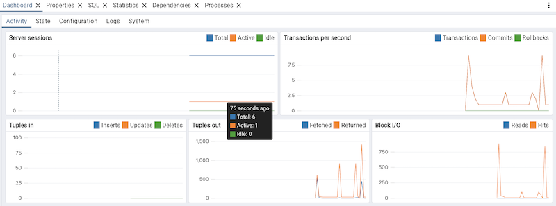
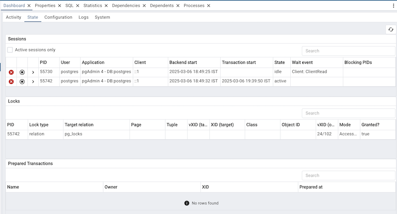
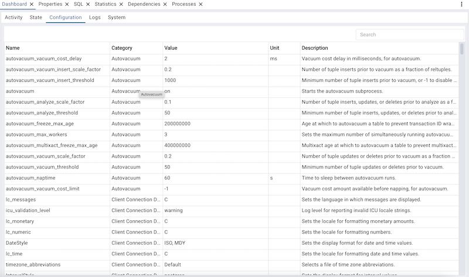
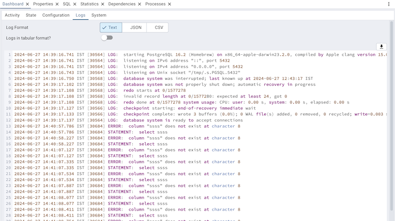
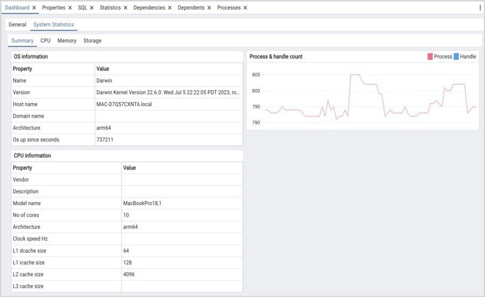
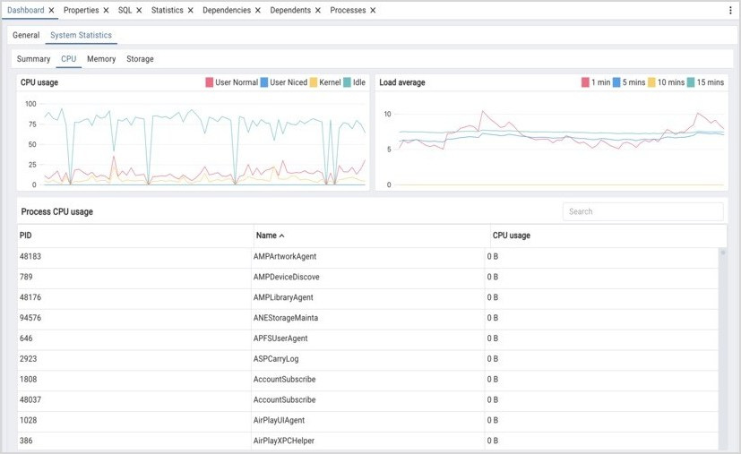
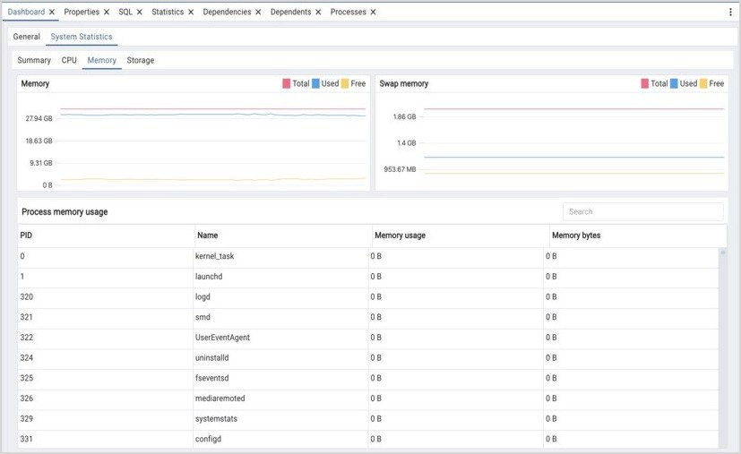
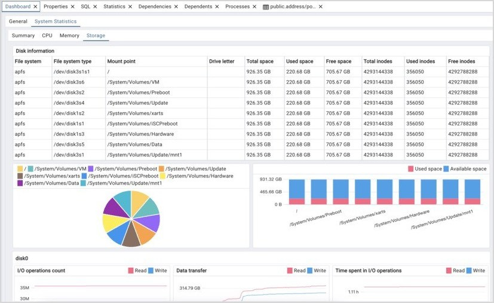

.. _dashboard:

******************
`Dashboard`:index:
******************

The graphs and tables on the *Dashboard* tab provides an active analysis of system statistics and the usage
statistics for the selected server or database.

Click the *Activity* tab to get the usage statistics for the selected server or database:

* The *Server sessions* or *Database sessions* graph displays interactions
  with the server or database. Server sessions are the number of connections
  to the DBMS, some of which may be idle when connection pooling is enabled in
  some client applications.
* The *Transactions per second* graph displays the commits, rollbacks, and
  total transactions per second that are taking place on the server or database.
* The *Tuples in* graph displays the number of tuples inserted, updated, and
  deleted on the server or database.
* The *Tuples out* graph displays the number of tuples fetched and returned
  from the server or database.
* The *Block I/O* graph displays the number of blocks read from the filesystem
  or fetched from the buffer cache (but not the operating system's file system
  cache) for the server or database.

Click the *Stat* tab to get the usage statistics for the selected server or database:

The *Stat* panel displays information about sessions, locks, prepared
transactions. The information is
presented in context-sensitive tables.  Use controls located above the table to:

* Click the *Refresh* button to update the information displayed in each table.
* Select *Active sessions only* checkbox to get the information about active sessions only from the list of all the sessions.
* Enter a value in the *Search* box to restrict the table content to one or more
  sessions that satisfy the search criteria.  For example, you can enter a
  process ID to locate a specific session, or a session state (such as *idle*)
  to locate all of the sessions that are in an idle state.

You can use icons in the *Sessions* table to review or control the state of a
session:

* Use the *Terminate* icon (located in the first column) to stop a session and
  remove the session from the table.  Before the server terminates the session,
  you will be prompted to confirm your selection.
* Use the *Cancel* icon (located in the second column) to terminate an active
  query without closing the session.  Before canceling the query, the server
  will prompt you to confirm your selection.  When you cancel a query, the
  value displayed in the *State* column of the table will be updated from
  *Active* to *Idle*.  The session will remain in the table until the session is
  terminated.
* Use the *Details* icon (located in the third column) to open the *Details*
  tab; the tab displays information about the selected session.

Click the *Configuration* tab to get the server configuration details.

Click the *Logs* tab to get the server logs.

* Use the Log Format switch to select the format you want. Text/Plain, JSON and CSV are supported.
  The enable/disable state of the log format depends on the Postgresql.conf setting.
* Use the Logs in tabular format? switch if you want to see the logs in a tabular format.

Click the *System Statistics* tab to get the statistics for the system:

Click the *Summary* tab to get the summary of the system:

* The *OS Information* table displays the basic information about the operating system.
* The *CPU Information* table displays the information about system CPU.
* The *Process & Handle Count* graph displays the total count of processes running and handles opened for the system.

Click the *CPU* tab to get the detailed usage statistics of the system CPU:

* The *CPU Usage* graph displays the percentage of time spent by CPU for user normal process, user niced process, kernel mode process, idle mode.
* The *Load average* graph displays the average load of the system over 1, 5, 10, and 15 minute intervals.
* The *Process CPU Usage* table displays information about CPU for each process ID. Enter a value like process ID or name in the Search box to restrict the table content to one or more processes that satisfy the search criteria.

Click the *Memory* tab to get the detailed usage statistics of the system memory:

* The *Memory Usage* graph displays the size of total, free and used memory per seconds in Gigabytes.
* The *Swap Memory* graph displays the size of total, free and used swap memory per seconds in Gigabytes.
* The *Process Memory Usage* table displays information about memory for each process ID. Enter a value like process ID or name in the Search box to restrict the table content to one or more processes that satisfy the search criteria.

Click the *Storage* tab to get the detailed information of the system storage:

* The *Disk Information* table displays the information about the disk, such as file system type, mount point, total space, used space and free space and count of total, free, used inodes. The pie graph shows the total spaces in Gigabytes and stacked bar graph shows the used and available space in Gigabytes, for different mount points for file system.
* The *Swap Memory* graph displays the size of total, free and used swap memory per seconds in Gigabytes.

The *disk0* panel displays statistics about the only I/O block device of system:

* The *I/O Operations Count* graph displays the count of read and write operations per second.
* The *Data Transfer* graph displays the size of read and writes happened in Gigabytes per second.
* The *Time spent in I/O operations* graph displays the time spent by the device for reading and writing in minutes per second.
