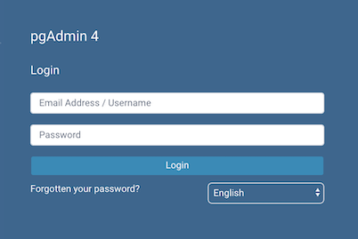
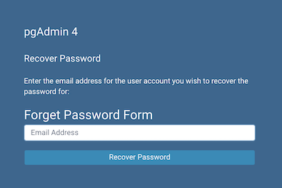

.. _login:

*********************
`Login Page`:index:
*********************

Use the *Login* page to log in to pgAdmin:

Use the fields in the *Login* page to authenticate your connection. There are
two ways to authenticate your connection:

- From pgAdmin version 4.21 onwards, support for LDAP authentication
  has been added. If LDAP authentication has been enabled for your pgAdmin
  application, you can use your LDAP credentials to log in to pgAdmin:

  * Provide the LDAP username in the *Email Address/Username* field.

  * Provide your LDAP password in the Password field.

- Alternatively, you can use the following information to log in to pgAdmin:

  * Provide the email address associated with your account in the
    *Email Address/Username* field.

  * Provide your password in the *Password* field.

Click the *Login* button to securely log into pgAdmin.

Please note that if the pgAdmin server is restarted, then you will be logged
out. You need to re-login to continue.

Recovering a Lost Password
**************************

If you cannot supply your password, click the *Forgotten your password?* button
to launch a password recovery utility.

* Provide the email address associated with your account in the *Email Address*
  field.
* Click the *Recover Password* button to initiate recovery. An email, with
  directions on how to reset a password, will be sent to the address entered in
  the *Email Address* field.

If you have forgotten the email associated with your account, please contact
your administrator.

Password recovery works only for accounts using the ``INTERNAL``
authentication source, which are the only accounts whose password pgAdmin
holds. Recovery looks up the email address you enter and acts on the ``INTERNAL``
account that has it: if one exists, reset instructions are sent for that
account. The password of an account authenticated against an external source
(``LDAP``, ``OAUTH2``, ``KERBEROS`` or ``WEBSERVER``) cannot be recovered here,
because it is held by that source; if the email belongs only to such an
account, an error asks you to contact that source's administrator. See
:ref:`Accounts from different authentication sources <auth_source_accounts>`.

.. _avoiding_bruteforce:

Avoiding a bruteforce attack
****************************

For accounts using the ``INTERNAL`` authentication source, pgAdmin locks
the account after ``MAX_LOGIN_ATTEMPTS`` consecutive failed logins. The
default is 3; set it to zero to disable.

For accounts authenticated against an external identity provider
(``LDAP``, ``OAUTH2``, ``KERBEROS``, ``WEBSERVER``), brute-force protection
is **not** handled by pgAdmin and ``MAX_LOGIN_ATTEMPTS`` does not apply.
Operators using these sources should:

- Configure account-lockout policy on the upstream provider (for example,
  Active Directory's account-lockout GPO, OpenLDAP's ``ppolicy`` overlay,
  or the OAuth2 provider's rate limits).
- Configure request rate-limiting (for example, ``limit_req`` in nginx)
  on the reverse proxy in front of pgAdmin to bound login-attempt volume
  per source IP.
