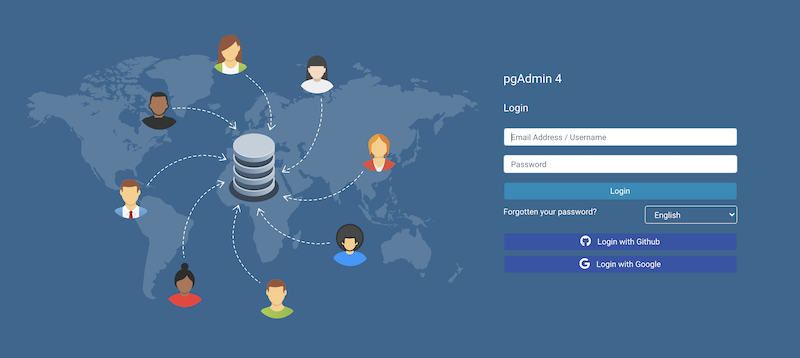

.. _oauth2:

*******************************************************
`Enabling OAUTH2 and OIDC Authentication`:index:
*******************************************************

To enable OAUTH2 or OpenID Connect (OIDC) authentication for pgAdmin, you must
configure the OAUTH2 settings in the *config_local.py* or *config_system.py*
file (see the :ref:`config.py <config_py>` documentation) on the system where
pgAdmin is installed in Server mode. You can copy these settings from *config.py*
file and modify the values for the following parameters.

.. warning::
   pgAdmin reads OAuth2 provider settings **only** from the ``OAUTH2_CONFIG``
   list; each provider is a single dictionary entry within that list. Settings
   such as ``OAUTH2_CLIENT_ID`` or ``OAUTH2_SSL_CERT_VERIFICATION`` defined at
   the top level of the configuration are ignored.

   This matters in container deployments. Although most options can be set with
   an individual ``PGADMIN_CONFIG_<KEY>`` environment variable, OAuth2 is the
   exception: individual variables such as ``PGADMIN_CONFIG_OAUTH2_CLIENT_ID``
   or ``PGADMIN_CONFIG_OAUTH2_SSL_CERT_VERIFICATION`` will **not** configure a
   provider. Instead, configure the whole provider list through a single
   ``PGADMIN_CONFIG_OAUTH2_CONFIG`` variable, for example::

       PGADMIN_CONFIG_OAUTH2_CONFIG="[{'OAUTH2_NAME': 'my-provider', 'OAUTH2_DISPLAY_NAME': 'My Provider', 'OAUTH2_CLIENT_ID': '...', 'OAUTH2_CLIENT_SECRET': '...', 'OAUTH2_SERVER_METADATA_URL': 'https://provider.example.com/.well-known/openid-configuration', 'OAUTH2_SCOPE': 'openid email profile', 'OAUTH2_SSL_CERT_VERIFICATION': False}]"

   If pgAdmin detects per-provider OAuth2 settings at the top level while no
   provider is configured in ``OAUTH2_CONFIG``, it logs a warning at startup
   to highlight the misconfiguration.

OAuth2 vs OpenID Connect (OIDC)
================================

pgAdmin supports both OAuth2 and OIDC authentication protocols:

**OAuth2** is an authorization framework that allows third-party applications to
obtain limited access to user accounts. When using OAuth2, pgAdmin must explicitly
call the provider's userinfo endpoint to retrieve user profile information.

**OpenID Connect (OIDC)** is an identity layer built on top of OAuth2 that provides
standardized user authentication and profile information. When using OIDC, user
identity information is included directly in the ID token, which is more efficient
and secure.

.. note::
   When **OAUTH2_SERVER_METADATA_URL** is configured, pgAdmin treats the provider
   as an OIDC provider and will:

   - Use ID token claims for user identity (sub, email, preferred_username)
   - Skip the userinfo endpoint call when ID token contains sufficient information
   - Validate the ID token automatically using the provider's public keys

   This is the **recommended approach** for modern identity providers like
   Microsoft Entra ID (Azure AD), Google, Keycloak, Auth0, and Okta.

.. _AzureAD: https://learn.microsoft.com/en-us/security/zero-trust/develop/configure-tokens-group-claims-app-roles
.. _GitLab: https://docs.gitlab.com/ee/integration/openid_connect_provider.html#shared-information

.. csv-table::
   :header: "**Parameter**", "**Description**"
   :class: longtable
   :widths: 35, 55

   "AUTHENTICATION_SOURCES", "The default value for this parameter is *internal*.
   To enable OAUTH2 authentication, you must include *oauth2* in the list of values
   for this parameter. You can modify the value as follows:

   * [‘oauth2’, ‘internal’]: pgAdmin will display an additional button for authenticating with oauth2"
    "OAUTH2_NAME", "The name of the Oauth2 provider, ex: Google, Github"
    "OAUTH2_DISPLAY_NAME", "Oauth2 display name in pgAdmin"
    "OAUTH2_CLIENT_ID", "Oauth2 Client ID"
    "OAUTH2_CLIENT_SECRET", "Oauth2 Client Secret. **Optional for public clients using Authorization Code + PKCE**. For confidential clients (server-side apps), keep this set. For public clients (no secret), pgAdmin will enforce PKCE and perform an unauthenticated token exchange."
    "OAUTH2_CLIENT_AUTH_METHOD", "Client authentication method for the token endpoint. Default behavior uses *OAUTH2_CLIENT_SECRET* (confidential client), or PKCE when no secret is provided (public client). Set to *workload_identity* to authenticate using an Azure Entra ID workload identity (federated credential) without a client secret."
    "OAUTH2_WORKLOAD_IDENTITY_TOKEN_FILE", "When **OAUTH2_CLIENT_AUTH_METHOD** is *workload_identity*, path to the projected OIDC token file (Kubernetes service account JWT). This file must exist at pgAdmin startup."
    "OAUTH2_TOKEN_URL", "Oauth2 Access Token endpoint"
    "OAUTH2_AUTHORIZATION_URL", "Endpoint for user authorization"
    "OAUTH2_SERVER_METADATA_URL", "**OIDC Discovery URL** (recommended for OIDC providers). When set, pgAdmin will use OIDC flow with automatic ID token validation and user claims from the ID token. Example: *https://login.microsoftonline.com/{tenant}/v2.0/.well-known/openid-configuration*. When using this parameter, OAUTH2_TOKEN_URL and OAUTH2_AUTHORIZATION_URL are optional as they will be discovered automatically."
    "OAUTH2_API_BASE_URL", "Oauth2 base URL endpoint to make requests simple, ex: *https://api.github.com/*"
    "OAUTH2_USERINFO_ENDPOINT", "User Endpoint, ex: *user* (for github, or *user/emails* if the user's email address is private) and *userinfo* (for google). **For OIDC providers**, this is optional if the ID token contains sufficient claims (email, preferred_username, or sub)."
    "OAUTH2_SCOPE", "Oauth scope, ex: 'openid email profile'. **For OIDC providers**, include 'openid' scope to receive an ID token."
    "OAUTH2_ICON", "The Font Awesome icon to be placed on the oauth2 button. A brand icon name (e.g. fa-github) uses the brands style by default; to use another style, include the style class explicitly (e.g. 'fas fa-key')."
    "OAUTH2_BUTTON_COLOR", "Oauth2 button color"
    "OAUTH2_USERNAME_CLAIM", "The claim which is used for the username. If the value is empty, **for OIDC providers** pgAdmin will use: 1) email, 2) preferred_username, or 3) sub (in that order). **For OAuth2 providers** without OIDC, email is required. Ex: *oid* (for AzureAD), *email* (for Github), *preferred_username* (for Keycloak)"
    "OAUTH2_AUTO_CREATE_USER", "Set the value to *True* if you want to automatically
    create a pgAdmin user corresponding to a successfully authenticated Oauth2 user.
    Please note that password is not stored in the pgAdmin database."
    "OAUTH2_AUTO_LOGIN", "Set the value to *True* to send users straight to the OAuth2 provider
    instead of showing the pgAdmin login page. This only takes effect when *oauth2* is the only
    value in AUTHENTICATION_SOURCES and exactly one provider is configured. The default is *False*.
    See :ref:`oauth2_auto_login` below."
    "OAUTH2_ADDITIONAL_CLAIMS", "If a dictionary is provided, pgAdmin will check for a matching key and value on the **ID token first** (for OIDC providers), then fall back to the userinfo endpoint response. In case there is no match with the provided config, the user will receive an authorization error. Useful for checking AzureAD_ *wids* or *groups*, GitLab_ *owner*, *maintainer* and *reporter* claims."
    "OAUTH2_SERVER_GROUP_CLAIM", "The name of a claim listing the server groups whose shared servers the user may access. If set, shared servers owned by other users are only visible and accessible if the name of their server group is in the claim. See :ref:`oauth2_server_group_claims` below."
    "OAUTH2_SERVER_GROUP_CLAIM_MAPPING", "An optional dictionary mapping values of the OAUTH2_SERVER_GROUP_CLAIM claim to a server group name or a list of server group names. Values without a mapping are used as server group names unchanged."
    "OAUTH2_SSL_CERT_VERIFICATION", "Set this variable to False to disable SSL certificate verification for OAuth2 provider.
    This may need to set False, in case of self-signed certificates."
    "OAUTH2_CHALLENGE_METHOD", "Enable PKCE workflow. PKCE method name, only *S256* is supported"
    "OAUTH2_RESPONSE_TYPE", "Enable PKCE workflow. Mandatory with OAUTH2_CHALLENGE_METHOD, must be set to *code*"
    "OAUTH2_LOGOUT_URL", "The provider's logout endpoint, used to end the user's session with the provider
    when they log out of pgAdmin. *{redirect_uri}* and *{id_token}* in the value are replaced with the pgAdmin
    URL and the user's ID token. Ex: *https://example.com/realms/master/protocol/openid-connect/logout?post_logout_redirect_uri={redirect_uri}&id_token_hint={id_token}* (for Keycloak)"

Redirect URL
============

The redirect url to configure Oauth2 server is *<http/https>://<pgAdmin Server URL>/oauth2/authorize*
After successful application authorization, the authorization server will redirect the user back to the pgAdmin url
specified here. Select https scheme if your pgAdmin server serves over https protocol otherwise select http.

Master Password
===============

In the multi user mode, pgAdmin uses user's login password to encrypt/decrypt the PostgreSQL server password.
In the Oauth2 authentication, the pgAdmin does not store the user's password, so we need an encryption key to store
the PostgreSQL server password.
To accomplish this, set the configuration parameter MASTER_PASSWORD to *True*, so upon setting the master password,
it will be used as an encryption key while storing the password. If it is False, the server password can not be stored.

Login Page
==========

After configuration, on restart, you can see the login page with the Oauth2 login button(s).

.. _oauth2_auto_login:

Skipping the Login Page
-----------------------

If OAuth2 is the only authentication source and a single provider is configured, set
OAUTH2_AUTO_LOGIN to *True* to send users straight to the provider rather than showing them the
login page with a single button. Note that any LOGIN_BANNER will not be seen in this case.

The login page is still shown after a login fails, so that the error can be read, and after the
user logs out, so that they are not logged straight back in by the provider. Setting
OAUTH2_LOGOUT_URL for the provider is recommended, so that logging out of pgAdmin also ends the
user's session with the provider. To show the login page at any other time, add *?no_auto_login*
to its URL, for example *https://pgadmin.example.com/login?no_auto_login*.

PKCE Workflow
=============

Ref: https://oauth.net/2/pkce

To enable PKCE workflow, set the configuration parameters OAUTH2_CHALLENGE_METHOD to *S256* and OAUTH2_RESPONSE_TYPE to *code*.
Both parameters are mandatory to enable PKCE workflow.

Public vs Confidential OAuth Clients
====================================

OAuth providers support two common client types:

- **Confidential clients** have a client secret and can authenticate to the token endpoint.
- **Public clients** do not have a client secret (or the secret cannot be safely stored).

pgAdmin supports interactive user login for both client types:

- If **OAUTH2_CLIENT_SECRET** is set, pgAdmin treats the provider as a confidential client.
- If **OAUTH2_CLIENT_SECRET** is missing, empty, or set to *None*, pgAdmin treats the provider as a public client and **requires PKCE**.

.. note::
    For public clients, pgAdmin uses Authlib's native behavior to perform an **unauthenticated token exchange**
    (token endpoint client authentication method: ``none``). This is required for Authorization Code + PKCE
    flows where no client secret is available.

Azure Entra ID Workload Identity (AKS) (No Client Secret)
=========================================================

pgAdmin can authenticate to Microsoft Entra ID (Azure AD) **without a client secret** using an
AKS Workload Identity projected service account token (OIDC federated credential).

This is a **confidential client** scenario (server-side app), but client authentication to the token
endpoint is performed using a **JWT client assertion**.

Enable workload identity mode
-----------------------------

Set the following parameters in your provider configuration:

.. code-block:: python

    OAUTH2_CONFIG = [{
        'OAUTH2_NAME': 'entra-workload-identity',
        'OAUTH2_DISPLAY_NAME': 'Microsoft Entra ID',
        'OAUTH2_CLIENT_ID': '<Application (client) ID>',
        'OAUTH2_CLIENT_SECRET': None,  # not required
        'OAUTH2_CLIENT_AUTH_METHOD': 'workload_identity',
        'OAUTH2_WORKLOAD_IDENTITY_TOKEN_FILE':
            '/var/run/secrets/azure/tokens/azure-identity-token',
        'OAUTH2_SERVER_METADATA_URL':
            'https://login.microsoftonline.com/<tenant-id>/v2.0/.well-known/openid-configuration',
        'OAUTH2_SCOPE': 'openid email profile',
    }]

With this configuration:

- pgAdmin will **not** require **OAUTH2_CLIENT_SECRET**.
- pgAdmin will **not** use PKCE for this provider.
- During the token exchange, pgAdmin will send:

    - ``client_assertion_type=urn:ietf:params:oauth:client-assertion-type:jwt-bearer``
    - ``client_assertion=<projected service account JWT>``

Azure App Registration setup
----------------------------

In Microsoft Entra ID:

- Create an **App registration** for pgAdmin.
- Configure a **Redirect URI** to ``<http/https>://<pgAdmin Server URL>/oauth2/authorize``.
- In **Certificates & secrets**, you do **not** need to create a client secret for workload identity.

Federated credential (workload identity) configuration
------------------------------------------------------

Add a **Federated credential** to the App registration:

- **Issuer**: your AKS cluster OIDC issuer URL.
- **Subject**: ``system:serviceaccount:<namespace>:<serviceaccount-name>``
- **Audience**: typically ``api://AzureADTokenExchange``

AKS ServiceAccount example
--------------------------

Example ServiceAccount for AKS Workload Identity:

.. code-block:: yaml

    apiVersion: v1
    kind: ServiceAccount
    metadata:
      name: pgadmin
      namespace: pgadmin
      annotations:
        azure.workload.identity/client-id: "<Application (client) ID>"
    ---
    apiVersion: apps/v1
    kind: Deployment
    metadata:
      name: pgadmin
      namespace: pgadmin
    spec:
      template:
        metadata:
          labels:
            azure.workload.identity/use: "true"
        spec:
          serviceAccountName: pgadmin

.. note::
    The projected token file path can vary by cluster configuration.
    In many AKS setups it is provided via the ``AZURE_FEDERATED_TOKEN_FILE`` environment
    variable and mounted under ``/var/run/secrets/azure/tokens/``.

OIDC Configuration Examples
============================

Using OIDC with Discovery Metadata (Recommended)
-------------------------------------------------

When using OIDC providers, configure the **OAUTH2_SERVER_METADATA_URL** parameter
to enable automatic discovery and ID token validation:

.. code-block:: python

    OAUTH2_CONFIG = [{
        'OAUTH2_NAME': 'my-oidc-provider',
        'OAUTH2_DISPLAY_NAME': 'My OIDC Provider',
        'OAUTH2_CLIENT_ID': 'your-client-id',
        'OAUTH2_CLIENT_SECRET': 'your-client-secret',
        'OAUTH2_SERVER_METADATA_URL': 'https://provider.example.com/.well-known/openid-configuration',
        'OAUTH2_SCOPE': 'openid email profile',
        # OAUTH2_USERINFO_ENDPOINT is optional when using OIDC
        # Token and authorization URLs are discovered automatically
    }]

With this configuration:

- pgAdmin will use the OIDC discovery endpoint to automatically find token and authorization URLs
- User identity will be extracted from ID token claims (sub, email, preferred_username)
- The userinfo endpoint will only be called as a fallback if ID token lacks required claims
- ID token will be automatically validated using the provider's public keys

Using OIDC as a Public Client (No Client Secret) with PKCE
-----------------------------------------------------------

If your OAuth/OIDC application is configured as a **public client** (no client secret), pgAdmin can still perform
interactive user login using Authorization Code + PKCE.

.. code-block:: python

    OAUTH2_CONFIG = [{
        'OAUTH2_NAME': 'my-oidc-public',
        'OAUTH2_DISPLAY_NAME': 'My OIDC Provider (Public Client)',
        'OAUTH2_CLIENT_ID': 'your-client-id',
        # Public client: omit OAUTH2_CLIENT_SECRET or set it to None/empty.
        'OAUTH2_CLIENT_SECRET': None,
        'OAUTH2_SERVER_METADATA_URL': 'https://provider.example.com/.well-known/openid-configuration',
        'OAUTH2_SCOPE': 'openid email profile',
        # PKCE is mandatory for public clients
        'OAUTH2_CHALLENGE_METHOD': 'S256',
        'OAUTH2_RESPONSE_TYPE': 'code',
    }]

With this configuration:

- pgAdmin enforces PKCE (challenge method + response type)
- The token exchange is performed without a client secret

Username Resolution for OIDC
-----------------------------

When **OAUTH2_SERVER_METADATA_URL** is configured (OIDC mode), pgAdmin will
resolve the username in the following order:

1. **OAUTH2_USERNAME_CLAIM** (if configured) - checks ID token first, then userinfo
2. **email** claim from ID token or userinfo endpoint
3. **preferred_username** claim from ID token (standard OIDC claim)
4. **sub** claim from ID token (always present in OIDC, used as last resort)

Example with custom username claim:

.. code-block:: python

    OAUTH2_CONFIG = [{
        # ... other config ...
        'OAUTH2_USERNAME_CLAIM': 'preferred_username',
        # pgAdmin will use 'preferred_username' from ID token for the username
    }]

Example without custom claim (uses automatic fallback):

.. code-block:: python

    OAUTH2_CONFIG = [{
        # ... other config ...
        # No OAUTH2_USERNAME_CLAIM specified
        # pgAdmin will try: email -> preferred_username -> sub
    }]

Additional Claims Authorization with OIDC
------------------------------------------

When using **OAUTH2_ADDITIONAL_CLAIMS** with OIDC providers, pgAdmin will:

1. Check the ID token claims first (more secure, no additional network call)
2. Fall back to userinfo endpoint response if needed

Example:

.. code-block:: python

    OAUTH2_CONFIG = [{
        # ... other config ...
        'OAUTH2_ADDITIONAL_CLAIMS': {
            'groups': ['admin-group', 'pgadmin-users'],
            'roles': ['database-admin']
        },
        # pgAdmin will check these claims in ID token first,
        # then userinfo endpoint if not found
    }]

.. _oauth2_server_group_claims:

Restricting Shared Servers with a Claim
---------------------------------------

**OAUTH2_SERVER_GROUP_CLAIM** limits which shared servers an OAuth2 user can
see, based on a claim from the identity provider such as a list of roles or
groups. When it is set:

* A shared server owned by another user is only visible, and can only be
  connected to, if the name of the server group it is in appears in the claim.
* If the claim is missing for a user, they see no shared servers owned by
  other users.
* Servers and server groups that the user owns themselves are not affected.
* Users who log in by other methods are not affected.

The claim is read from the ID token first, then from the userinfo endpoint
response. Its value may be a string or a list of strings; values of any other
type (for example, group objects returned by some providers) are ignored.
Server group names are matched exactly, with no trimming or case folding.

**OAUTH2_SERVER_GROUP_CLAIM_MAPPING** can be used to translate claim values
into server group names. A value may map to a single name or a list of names,
and values with no mapping are used as server group names unchanged.

The claim is only read when the user logs in, so changes made at the identity
provider take effect at the user's next login.

Example:

.. code-block:: python

    OAUTH2_CONFIG = [{
        # ... other config ...
        'OAUTH2_SERVER_GROUP_CLAIM': 'roles',
        'OAUTH2_SERVER_GROUP_CLAIM_MAPPING': {
            'dba': ['Production', 'Staging'],
            'developer': 'Staging'
        },
        # A user with the roles ['developer', 'Reporting'] can see shared
        # servers in the 'Staging' and 'Reporting' server groups.
    }]

Legacy OAuth2 Configuration (Without OIDC)
-------------------------------------------

For providers that don't support OIDC discovery, configure all endpoints manually:

.. code-block:: python

    OAUTH2_CONFIG = [{
        'OAUTH2_NAME': 'github',
        'OAUTH2_DISPLAY_NAME': 'GitHub',
        'OAUTH2_CLIENT_ID': 'your-client-id',
        'OAUTH2_CLIENT_SECRET': 'your-client-secret',
        'OAUTH2_TOKEN_URL': 'https://github.com/login/oauth/access_token',
        'OAUTH2_AUTHORIZATION_URL': 'https://github.com/login/oauth/authorize',
        'OAUTH2_API_BASE_URL': 'https://api.github.com/',
        'OAUTH2_USERINFO_ENDPOINT': 'user',
        'OAUTH2_SCOPE': 'user:email',
        # No OAUTH2_SERVER_METADATA_URL - pure OAuth2 mode
    }]

In this mode, user identity is retrieved only from the userinfo endpoint.

.. _oauth2_postgresql:

Using a pgAdmin OAuth token with PostgreSQL
-------------------------------------------

Users signed in to pgAdmin through an OIDC provider can use
``oauth_pgadmin_token_mode`` to supply an access token for PostgreSQL OAuth
authentication. This uses an OAuth access token, not an OIDC ID token.

Prerequisites
~~~~~~~~~~~~~

* Configure OIDC login for pgAdmin as described on this page and sign in
  through that OIDC provider.
* Configure PostgreSQL OAuth authentication, including a token validator,
  the expected issuer and scopes, and authorization for the database role.
* Use PostgreSQL 18 or later. The libpq loaded by pgAdmin must be version
  18.x, with a supported Psycopg implementation as described below.

Configure the connection
~~~~~~~~~~~~~~~~~~~~~~~~

In the *Parameters* tab of the Server dialog, add *OAuth pgAdmin token mode*
(``oauth_pgadmin_token_mode``). Select ``direct`` or ``exchange`` to enable
this integration.

Both ``direct`` and ``exchange`` require ``oauth_client_id`` and
``oauth_issuer``. The issuer must match the PostgreSQL OAuth configuration
and the issuer used for the pgAdmin login token.

For example:

.. code-block:: text

   oauth_pgadmin_token_mode = exchange
   oauth_client_id = postgres-cluster-01
   oauth_issuer = https://identity.example.com/realms/postgres

Replace the example values with those configured for your deployment. Set
the *Username* field to the database role authorized by the server's OAuth
configuration.

Use a trusted database endpoint. For TCP connections, configure certificate
and hostname verification, for example with ``sslmode=verify-full`` and a
trusted root certificate. Database TLS settings are separate from those for
the OIDC provider's HTTPS endpoints.

Direct mode
~~~~~~~~~~~

In ``direct`` mode, pgAdmin forwards the access token from the current user's
login session to PostgreSQL. The database validator must accept its issuer,
audience and scopes and authorize the requested database role. The audience
depends on the OIDC provider's configuration; it is not necessarily the
pgAdmin OAuth client identifier.

.. warning::

   The database server receives the login access token, which its operator
   may be able to reuse wherever that token is accepted. Use direct mode
   only with trusted servers and a policy explicitly permitting this reuse.
   Prefer exchange mode when the OIDC provider can issue a token restricted
   to the target database.

Exchange mode
~~~~~~~~~~~~~

In ``exchange`` mode, pgAdmin exchanges the login access token and supplies
the resulting token to PostgreSQL. If exchange fails, the connection attempt
fails; pgAdmin does not fall back to direct mode.

The token endpoint belongs to the OIDC provider used for pgAdmin login.
``OAUTH2_TOKEN_URL`` takes precedence over the ``token_endpoint`` in the
OIDC provider's discovery metadata. HTTPS is required and token endpoint
redirects are not followed.

.. list-table:: Token exchange request
   :header-rows: 1
   :widths: 30 70

   * - Parameter
     - Value
   * - ``grant_type``
     - ``urn:ietf:params:oauth:grant-type:token-exchange``
   * - ``client_id``
     - The server connection's ``oauth_client_id``.
   * - ``subject_token``
     - The pgAdmin login access token, refreshed when required and possible.
   * - ``subject_token_type``
     - ``urn:ietf:params:oauth:token-type:access_token``
   * - ``scope``
     - The server connection's ``oauth_scope``, when non-empty.
       Otherwise omitted; the OIDC provider determines the scopes.

Token exchange uses the scopes explicitly configured in the server
connection's ``oauth_scope`` parameter. If it is unset or blank, pgAdmin
omits ``scope`` from the exchange request and the OIDC provider determines
the scopes. Exchange occurs before connecting to PostgreSQL, so it cannot
use scopes advertised by the database server. Configure ``oauth_scope``
when the OIDC provider's defaults do not meet the database's requirements.

The OIDC provider must support and authorize this request without additional
client authentication. The implementation does not send an exchange client
secret or other client authentication credentials.

.. important::

   The request does not send ``audience`` or ``resource``. Its ``client_id``
   alone does not guarantee a database-specific token. Configure the OIDC
   provider to issue the intended audience and permissions, and the database
   validator to enforce them.

The OIDC provider must return a non-empty ``access_token`` with a
``token_type`` of ``Bearer``. Exchanged tokens are not cached or stored in the
pgAdmin login session. Each connection attempt using this mode performs a
new exchange.

TLS verification for exchange
~~~~~~~~~~~~~~~~~~~~~~~~~~~~~

Exchange requires TLS certificate verification for the OIDC provider. Keep
``OAUTH2_SSL_CERT_VERIFICATION`` enabled in its ``OAUTH2_CONFIG`` entry.
Disabled verification is rejected before any token refresh, metadata request
or exchange is attempted as part of preparing the database connection.

For a private certificate authority, configure a trusted CA bundle for the
OAuth client. The exchange request reuses the login OAuth client's
verification setting, including a configured CA-bundle path.

Supported client implementations
~~~~~~~~~~~~~~~~~~~~~~~~~~~~~~~~

These requirements apply to the libpq loaded in the pgAdmin process:

.. list-table:: Psycopg implementation requirements
   :header-rows: 1
   :widths: 20 80

   * - Implementation
     - Requirements
   * - ``python``
     - Reuses Psycopg's libpq handle. Requires a discoverable libpq 18.x
       installation compatible with pgAdmin's Python runtime.
   * - ``c``
     - Linux only. Requires libpq 18.x and an unambiguous loaded libpq
       candidate. Missing or ambiguous candidates are rejected.
   * - ``binary``
     - Not supported by this integration, even with bundled libpq 18.x.

To select the Python implementation, set ``PSYCOPG_IMPL=python`` in the
pgAdmin process environment and restart the backend. This affects all
connections in that process. It is not a connection parameter or a
``PGADMIN_CONFIG_`` setting and does not install or upgrade libpq.

Windows and macOS require the Python implementation and a compatible,
discoverable libpq 18.x installation. The installed pgAdmin package must
support that configuration. In containers, configure the environment and
libraries inside the container.

Token refresh and reconnects
~~~~~~~~~~~~~~~~~~~~~~~~~~~~

When expiration information is available, pgAdmin attempts to refresh the
login access token if it has expired or will expire within 30 seconds. A
successful refresh updates the login session. If the refresh token is
unavailable or refreshing fails, sign in again before retrying the connection.

Token retrieval, refresh and exchange require an authenticated pgAdmin
request. Reconnects made through such requests are supported. Independent
background connection attempts without the user's request context are not;
initiate reconnection through pgAdmin. Existing database connections do not
require a new token exchange for each query.
